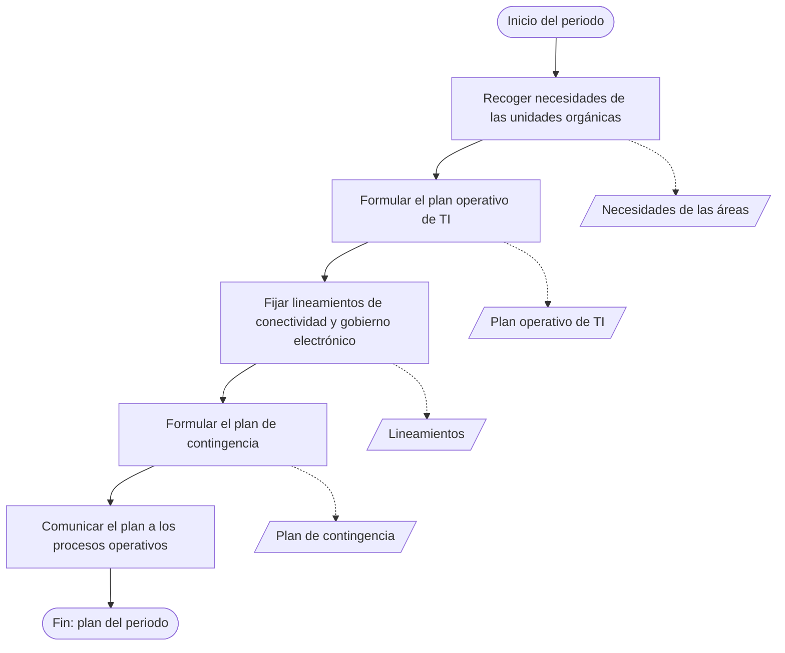
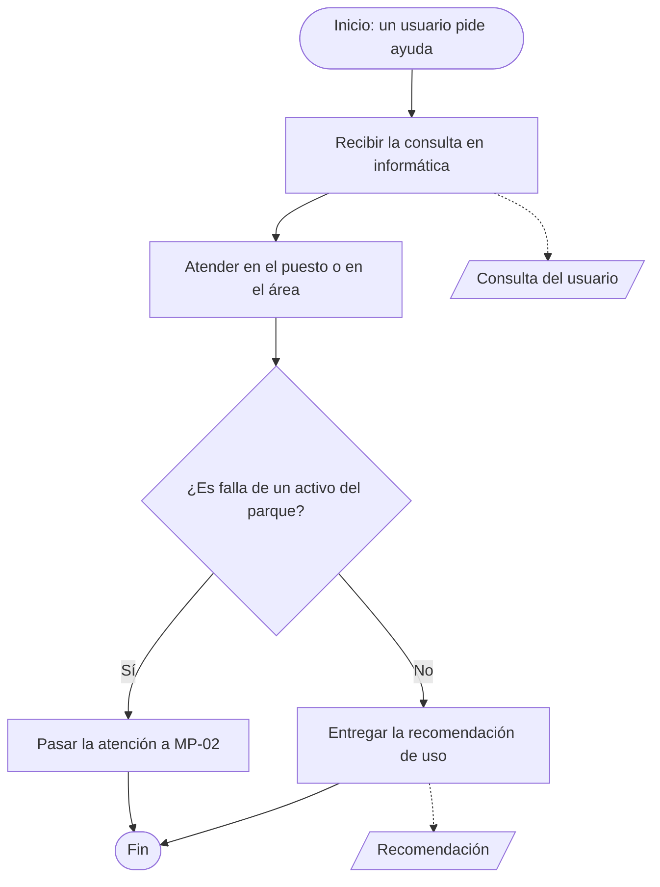

# MP-00, MP-04, MP-05 y MP-06

**Prompt:** [P-ISO-001](../../../prompts/iso/P-ISO-001_mapa_macroprocesos_v1.md)  
**Autoría:** elaboración propia. La municipalidad no tiene mapa de procesos. La secuencia sale de los verbos del artículo 111 del ROF.  
**Estado:** desglose as-is / to-be. Pendiente de revisión humana.

Sigemad no sustituye estos cuatro procesos. El to-be repite el as-is, salvo el enlace que se indica. No llevan ticket, proveedor ni conformidad del usuario.

## MP-00 — Planificación de tecnologías de la información

Tipo: **estratégico**. Art. 111, nums. 4, 7 y 9. Dueño: jefe de la Unidad de TI.

As-is y to-be son el mismo recorrido. Sigemad no guarda el plan.

| Orden | Actividad | Lee | Escribe |
|-------|-----------|-----|---------|
| 1 | Recoger lo que las unidades necesitan del periodo | Pedidos de las áreas | Listado de necesidades |
| 2 | Formular el plan operativo y alinearlo al plan estratégico de TI | Necesidades | Plan operativo |
| 3 | Definir lineamientos de conectividad y gobierno electrónico | Plan operativo | Lineamientos |
| 4 | Formular el plan de contingencia de la información | Lineamientos | Plan de contingencia |
| 5 | Entregar esos documentos a MP-01, MP-02, MP-04 y MP-05 | Los tres documentos | — |

No se abre un proceso aparte de seguridad, innovación o transformación digital. Esos temas, cuando aparecen, quedan dentro de los nums. 4 y 9.

## MP-04 — Asistencia técnica a usuarios

Tipo: **operativo**. Art. 111, nums. 6 y 14. Ejecuta el técnico de informática.

| Orden | Actividad | As-is | To-be |
|-------|-----------|-------|-------|
| 1 | Recibir la consulta | El técnico la toma. No hay ticket | Igual |
| 2 | Atender al usuario | En el puesto o yendo al área | Igual |
| 3 | Si el caso es falla de un PC, laptop, monitor, impresora, escáner u otro | Sigue el as-is de PR-02-01, sin ficha en sistema | El técnico abre el to-be de PR-02-01 y registra la ficha |
| 4 | Si el caso es uso del recurso instalado | Entrega la recomendación. Art. 111 num. 14 | Igual. Sigemad no guarda esa recomendación |

## MP-05 — Operación de la plataforma tecnológica

Tipo: **operativo**. Art. 111, nums. 5, 8 y 10. Dueño: jefe de la unidad. As-is y to-be coinciden. El portal no entra a Sigemad.

| Orden | Actividad | Lee | Escribe | Numeral |
|-------|-----------|-----|---------|---------|
| 1 | Revisar el software en uso y el equipamiento de las unidades | Parque instalado | Nota de lo que sigue operativo | 5 |
| 2 | Operar la red, la conectividad y las copias de respaldo | Plataforma | Servicio de red disponible | 8 |
| 3 | Actualizar el portal con imagen institucional y la gerencia municipal | Contenido a publicar | Portal actualizado | 10 |

Objetos: nota de operación, copia de respaldo y publicación del portal. Ninguno vive en Sigemad.

## MP-06 — Recursos de TI

Tipo: **de soporte**. Art. 111, nums. 12, 16 y 13. La compra la hace Abastecimiento.

| Orden | Actividad | As-is | To-be |
|-------|-----------|-------|-------|
| 1 | Revisar qué software está en uso y si la licencia alcanza | Control de la unidad | Igual. Sigue fuera de Sigemad |
| 2 | Redactar la especificación técnica del equipo o del software que hace falta | La elabora informática y la entrega a Abastecimiento | Igual. Puede mirar los conteos de MP-01 para saber cuántos activos hay. Abastecimiento sigue contratando |
| 3 | Capacitar al personal de la municipalidad en lo que compete al área | Sesión o indicación al usuario | Igual. No hay módulo de capacitación |

Objetos: control de licencias, especificación técnica, registro de la capacitación. Los tres quedan en la unidad. La especificación es la salida hacia Abastecimiento.
