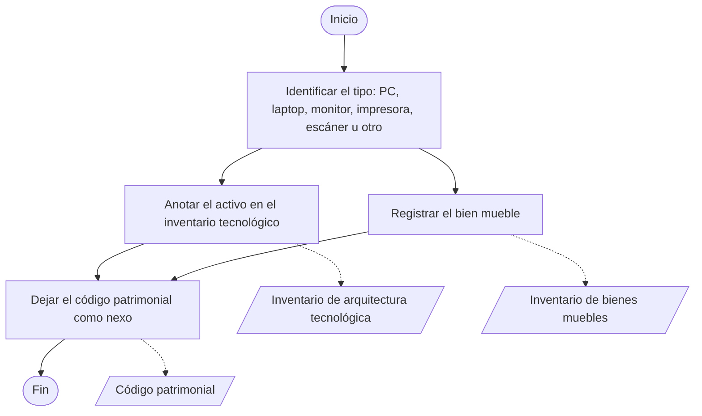
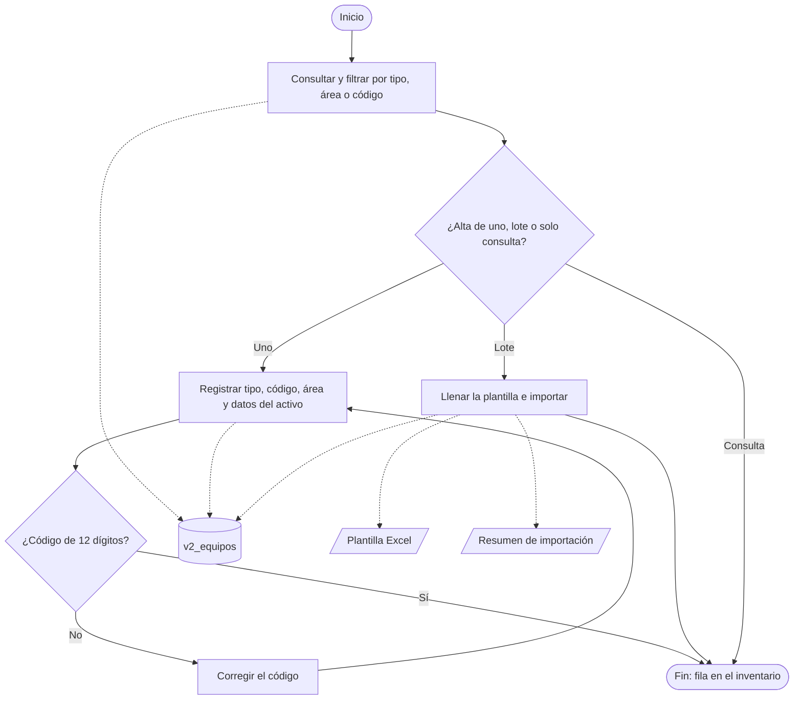
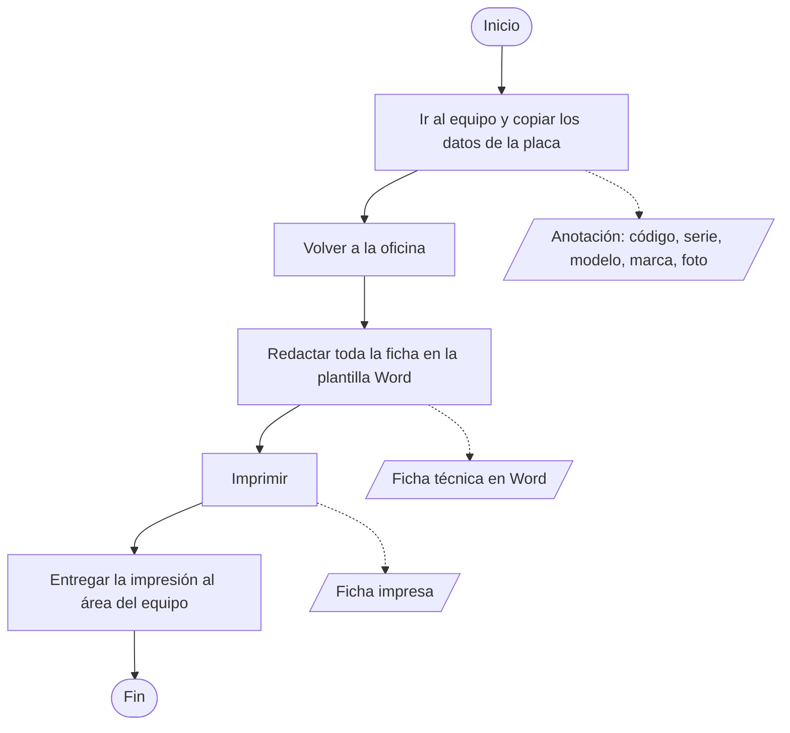
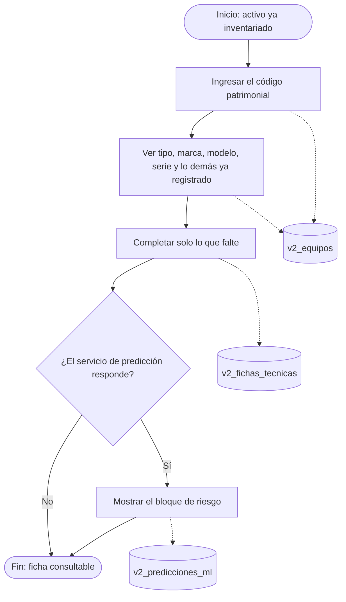

# MP-01 — Gestión de activos informáticos

**Prompt:** [P-ISO-003](../../../prompts/iso/P-ISO-003_mp01_activos_v1.md)  
**Tipo en el nivel 0:** operativo.  
**Estado:** desglose as-is / to-be por procedimiento. Pendiente de revisión humana.  
**Autoría:** elaboración propia. La municipalidad no tiene mapa de procesos.  
**Fuentes:** ROF art. 111 num. 11 y art. 90 num. 3. To-be: PR-01-01, PR-01-02 y PR-01-03.

El parque lo ve y lo registra solo el área de informática: PC (CPU), laptop, monitor, impresora, escáner y «Otro». El área usuaria es la ubicación del bien. En Bizagi, el objeto de datos va con línea punteada.

| Procedimiento | As-is | To-be |
|---------------|-------|-------|
| PR-01-01 Control de inventario | Informática identifica el activo y lo anota en su inventario; Patrimonio anota el bien mueble | Alta, edición o lote en Sigemad, con código de 12 dígitos |
| PR-01-02 Ficha técnica | El técnico levanta los datos en el equipo, redacta la plantilla Word, la imprime y la entrega al área | La ficha se completa en Sigemad y el PDF sustituye la impresión |
| PR-01-03 Reportes | El archivo Word es el documento que se guarda | El sistema genera el PDF de la ficha |

## PR-01-01 — Control de inventario

### As-is

Carriles: Unidad de TI y Unidad de Patrimonio.

| Orden | Actividad | Carril | Lee | Escribe |
|-------|-----------|--------|-----|---------|
| 1 | Identificar el activo y su tipo | Unidad de TI | Equipo físico | Tipo de activo |
| 2 | Anotarlo en el inventario de la unidad, con el área donde está | Unidad de TI | Tipo y área | Inventario de arquitectura tecnológica |
| 3 | Registrar el bien en el inventario general | Unidad de Patrimonio | Datos del bien | Inventario de bienes muebles e inmuebles |
| 4 | Conservar el código patrimonial en los dos inventarios | Unidad de TI y Patrimonio | Ambos inventarios | Código patrimonial |

El soporte del inventario tecnológico no está en el ROF. No se le pone nombre de archivo.

### To-be

Carril: personal de informática (Administrador, Técnico o Practicante). El lote lo importa solo el Administrador.

| Orden | Actividad | Quién | Lee | Escribe |
|-------|-----------|-------|-----|---------|
| 1 | Consultar y filtrar | Administrador, Técnico o Practicante | `v2_equipos`, área, tipo | — |
| 2 | Registrar o actualizar un activo | Informática | Código, tipo, `v2_areas` | Fila en `v2_equipos` |
| 3 | Corregir el código si no tiene 12 dígitos y volver al paso 2 | Quien registra | Código rechazado | — |
| 4 | Descargar la plantilla, llenarla e importar el lote | Administrador | Plantilla Excel | Filas en `v2_equipos` y resumen de importación |

La impresora guarda contador de páginas. El monitor, el escáner y «Otro» se registran igual; no entran en la marca Xn de MP-02.

## PR-01-02 — Ficha técnica

### As-is

Declaración del caso: el técnico iba al equipo y copiaba a mano lo que veía en el aparato (código patrimonial, número de serie, modelo, marca y el resto). Volvía a la oficina, redactaba todo en la plantilla Word, imprimía y recién entonces entregaba la hoja al área.

| Orden | Actividad | Carril | Lee | Escribe |
|-------|-----------|--------|-----|---------|
| 1 | Ir al equipo y copiar del aparato el código patrimonial, la serie, el modelo, la marca, el tipo y los demás datos visibles. Tomar una foto | Técnico de informática | Placa del equipo | Anotación y foto |
| 2 | Volver a la oficina | Técnico de informática | La anotación | — |
| 3 | Redactar toda la ficha en la plantilla Word | Técnico de informática | Anotación y plantilla | Ficha técnica en Word |
| 4 | Imprimir la ficha | Técnico de informática | Archivo Word | Ficha impresa |
| 5 | Entregar la impresión al área donde está el equipo | Técnico de informática | Ficha impresa | El Word queda en informática |

No hay un PDF generado por un sistema. Cada ficha repetía esa recolección.

### To-be

| Orden | Actividad | Quién | Lee | Escribe |
|-------|-----------|-------|-----|---------|
| 1 | Ingresar el código patrimonial | Técnico | Código | — |
| 2 | Ver los datos ya registrados: tipo, marca, modelo, serie y los demás del inventario | Técnico | `v2_equipos` | — |
| 3 | Completar solo lo que falte: hardware, software y evaluación | Técnico | Lo que ya mostró el sistema | `v2_fichas_tecnicas` |
| 4 | Consultar el bloque de riesgo, si el servicio responde | Técnico o Administrador | `v2_predicciones_ml` | — |

El técnico no vuelve a copiar la placa para armar la ficha. Con el código, el sistema completa los datos guardados en el alta y muestra otros más, como el área y el riesgo. La entrega al área pasa a ser el PDF de PR-01-03.

Si el servicio no responde, la ficha del paso 2 queda cerrada (ADR-002).

## PR-01-03 — Reportes patrimoniales

### As-is

Lo que se entrega al área es la ficha impresa del procedimiento anterior. Informática conserva el Word. No se dibuja un PDF.

### To-be

| Orden | Actividad | Quién | Lee | Escribe |
|-------|-----------|-------|-----|---------|
| 1 | Generar el PDF de la ficha | Quien consulta, con sesión | `v2_equipos` y `v2_fichas_tecnicas` | PDF de ficha |
| 2 | Descargar el PDF | El mismo usuario | El PDF | Archivo descargado |

Sin sesión no hay descarga.

## Objetos del to-be

| Objeto | Tipo | Procedimiento |
|--------|------|----------------|
| Tipo de activo | Dato | PR-01-01 |
| Código patrimonial de 12 dígitos | Dato | PR-01-01. Lo usan la ficha, el PDF y MP-02 |
| Área | Dato `v2_areas` | PR-01-01. Ubicación, no dueño del inventario |
| Registro del activo | Almacén `v2_equipos` | PR-01-01 |
| Plantilla Excel y resumen de importación | Documentos | PR-01-01, solo lote |
| Ficha técnica | Almacén `v2_fichas_tecnicas` | PR-01-02 |
| Riesgo | Almacén `v2_predicciones_ml` | PR-01-02. Puede no existir |
| PDF de ficha | Documento | PR-01-03 |

## No dibujar

- Traslado, reasignación y baja del activo.
- Patrimonio como pantalla de Sigemad.
- Un archivo con nombre propio para el inventario anterior.
- Licencias, portal, redes y compras. Van en MP-05 y MP-06.
