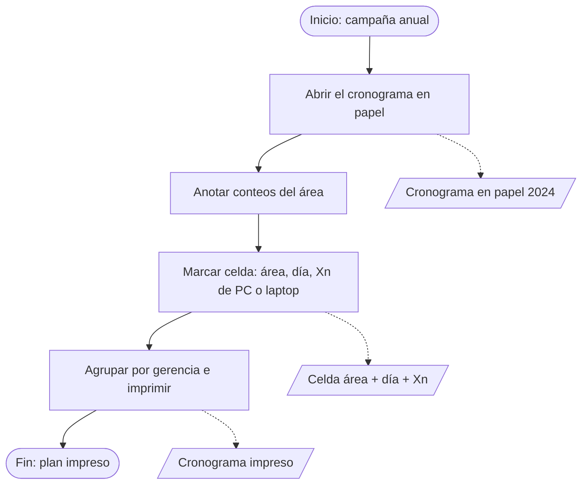
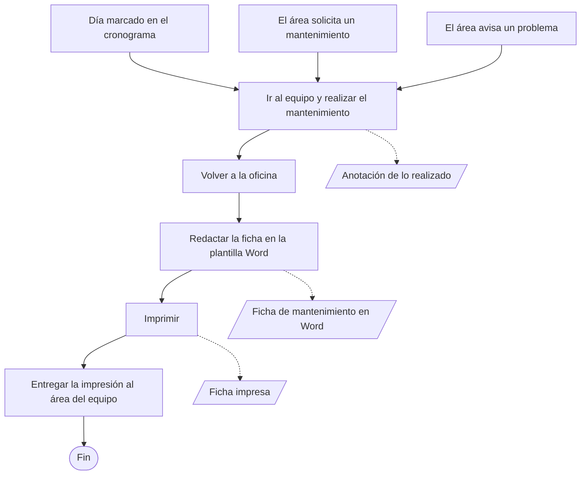
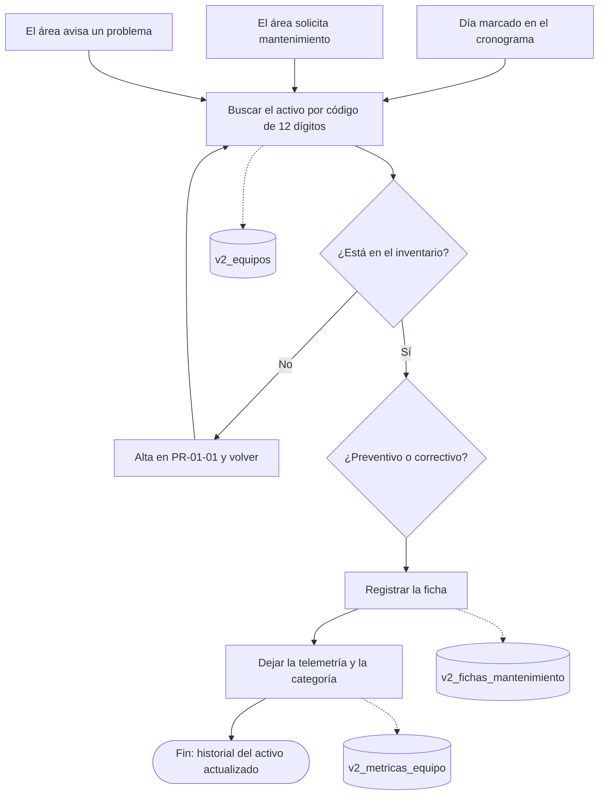

# MP-02 — Mantenimiento de recursos informáticos

**Prompt:** [P-ISO-002](../../../prompts/iso/P-ISO-002_mp02_mantenimiento_v1.md)  
**Tipo en el nivel 0:** operativo.  
**Estado:** desglose as-is / to-be por procedimiento. Pendiente de revisión humana.  
**Autoría:** elaboración propia. La municipalidad no tiene mapa de procesos.  
**Fuentes:** ROF art. 111 num. 3. As-is del preventivo: cronograma en papel 2024 (R-006). To-be: PR-02-01 a PR-02-04.

Lo ejecuta informática sobre el parque de MP-01. Cada equipo informático se mantiene al menos una vez al año: por eso existe el cronograma. La celda propone el día de ese preventivo. Si cualquier área solicita un mantenimiento, o avisa que un equipo falló, informática lo atiende igual, aunque ese activo no esté marcado ese día. La ficha es la ejecución. La celda no la reemplaza. Xn cuenta solo PC y laptop. La impresora se cuenta en la fila del área y puede tener ficha. Escáner, monitor y «Otro» pueden tener ficha y no entran en Xn.

En Bizagi, el objeto de datos va con línea punteada.

| Procedimiento | As-is | To-be |
|---------------|-------|-------|
| PR-02-03 Programación anual | Papel 2024: celda por área y día, Xn manual, impreso por gerencia | Documento en Sigemad, celda Xn, personal, banda de gerencia y PDF A4 |
| PR-02-01 Intervención | Igual que la ficha técnica: ir al equipo, volver a la oficina, redactar el Word, imprimir y entregar. Cambia el contenido: es el mantenimiento | Ficha del mismo activo en Sigemad. Con el código aparecen los datos del equipo |
| PR-02-04 Reportes | Se guarda el archivo Word de esa ficha | PDF de historial y PDF de detalle |
| PR-02-02 Priorización | El jefe supervisa sin un puntaje de riesgo | Consulta de riesgo, opcional |

## PR-02-03 — Programación anual del preventivo

El cronograma se arma para cumplir el mínimo de una vez al año. No cierra la puerta a otras atenciones.

### As-is

| Orden | Actividad | Carril | Lee | Escribe |
|-------|-----------|--------|-----|---------|
| 1 | Abrir el cronograma del año | Unidad de TI | Papel | — |
| 2 | Anotar en la fila del área cuántos PC, laptop e impresoras hay | Unidad de TI | Conteos del papel | La misma fila |
| 3 | Marcar a mano el día y la cantidad Xn | Unidad de TI | La fila | Celda. Xn no incluye impresora, escáner ni monitor |
| 4 | Agrupar áreas por gerencia e imprimir | Unidad de TI | Papel marcado | Cronograma impreso |

### To-be

| Orden | Actividad | Quién | Lee | Escribe |
|-------|-----------|-------|-----|---------|
| 1 | Crear o abrir un cronograma del historial, con año y nombre | Administrador o Técnico | Historial | `v2_cronogramas` |
| 2 | Ver conteos de PC, laptop e impresora del área | Administrador o Técnico | `v2_equipos` | Conteos en pantalla. No se guardan |
| 3 | Marcar la celda del día laborable con Xn | Administrador o Técnico | Área y fecha | `v2_cronograma_celdas` |
| 4 | Asignar el personal y mostrar la banda de gerencia | Administrador | Personal y gerencias | `v2_cronograma_personal` |
| 5 | Emitir el PDF A4, dos meses por hoja, lunes a viernes | Administrador o Técnico | Documento, celdas y conteos | PDF A4 |
| 6 | Dar de baja el documento si sobra, con confirmación | Administrador | El cronograma | El historial queda sin ese documento |

Puede haber varios cronogramas en el mismo año. El practicante no borra. La baja del paso 6 es del plan, no del equipo.

## PR-02-01 — Intervención técnica

### As-is

El recorrido es el de la ficha técnica. Cambia el motivo y lo que se anota: aquí es el mantenimiento del equipo, no la descripción del aparato.

El día marcado cumple la visita anual. Una solicitud de cualquier área, o el aviso de un problema, se atiende igual, aunque ese equipo no esté en la celda.

| Orden | Actividad | Carril | Lee | Escribe |
|-------|-----------|--------|-----|---------|
| 1 | Recibir el día del cronograma, la solicitud del área o el aviso de un problema | Unidad de TI | Cronograma en papel, o el aviso | Necesidad. El canal no se nombra |
| 2 | Ir al equipo y hacer el preventivo o el correctivo. Anotar en el lugar lo realizado | Técnico de informática | El equipo | Anotación del trabajo |
| 3 | Volver a la oficina | Técnico de informática | La anotación | — |
| 4 | Redactar toda la ficha de mantenimiento en la plantilla Word | Técnico de informática | Anotación y plantilla | Ficha de mantenimiento en Word |
| 5 | Imprimir la ficha | Técnico de informática | Archivo Word | Ficha impresa |
| 6 | Entregar la impresión al área donde está el equipo | Técnico de informática | Ficha impresa | El Word queda en informática |

La celda del cronograma no reemplaza esta ficha. No hay PDF del sistema ni un historial ligado al código.

### To-be

| Orden | Actividad | Quién | Lee | Escribe |
|-------|-----------|-------|-----|---------|
| 1 | Recibir el día marcado, la solicitud del área o el aviso de un problema, y buscar el activo por código | Técnico | Código, `v2_equipos` | — |
| 2 | Si no está, darlo de alta en PR-01-01 y volver al paso 1 | Técnico | — | Fila de `v2_equipos` |
| 3 | Elegir preventivo o correctivo | Técnico | Tipo de necesidad | — |
| 4 | Registrar la ficha: técnico y, si es correctivo, categoría de falla | Técnico | Activo y catálogo de categorías | `v2_fichas_mantenimiento` |
| 5 | Registrar la telemetría de esa intervención | Técnico | Lecturas del activo | `v2_metricas_equipo` |
| 6 | Consultar el historial de ese código | Técnico | Fichas del activo | — |

Igual que en la ficha técnica, el código patrimonial trae los datos del equipo. El técnico registra el mantenimiento, no vuelve a copiar la placa en Word ni a imprimir para entregar. El PDF de PR-02-04 es lo que queda del trabajo.

## PR-02-04 — Reportes de mantenimiento

### As-is

El reporte es el archivo Word guardado en PR-02-01. No se dibuja un PDF.

### To-be

| Orden | Actividad | Quién | Lee | Escribe |
|-------|-----------|-------|-----|---------|
| 1 | Emitir el PDF del historial del activo | Técnico | Fichas de ese código | PDF de historial |
| 2 | Emitir el PDF de una intervención | Técnico | Una ficha | PDF de detalle |

## PR-02-02 — Priorización

### As-is

La supervisión del jefe (PR-02-01, paso 4) es la única prioridad documentada. No hay puntaje. No se dibuja un cálculo.

### To-be

| Orden | Actividad | Quién | Lee | Escribe |
|-------|-----------|-------|-----|---------|
| 1 | Consultar el riesgo de un activo o de un lote | Técnico o Administrador | Datos del activo | `v2_predicciones_ml`, si el servicio responde |
| 2 | Seguir operando si el servicio no responde | Quien registra | — | La ficha de PR-02-01 ya está cerrada |
| 3 | Reentrenar el modelo | Administrador | Historial de fichas | Modelo actualizado |

El paso 1 no ordena solo el cronograma. La celda Xn sigue siendo manual.

## Objetos

| Objeto | As-is | To-be |
|--------|-------|-------|
| Necesidad de mantenimiento | Tres entradas: día del cronograma, solicitud del área o aviso de un problema. El canal no se nombra | Las mismas tres entradas. Luego se busca el código |
| Cronograma | Papel 2024 | `v2_cronogramas` |
| Celda Xn | Dato en el papel. Solo PC y laptop | `v2_cronograma_celdas` |
| Conteos PC, laptop, impresora | Anotados en la fila | Calculados desde `v2_equipos`. No se guardan |
| Impreso / PDF del plan | Cronograma impreso | PDF A4 |
| Personal y banda de gerencia | Agrupación manuscrita por gerencia | `v2_cronograma_personal` y catálogo de gerencias |
| Ficha de intervención | Plantilla Word redactada a mano | `v2_fichas_mantenimiento` |
| Telemetría | No existe | `v2_metricas_equipo` |
| PDF de historial y de detalle | No existen. El as-is conserva el Word | Documentos de PR-02-04 |
| Riesgo | No existe | `v2_predicciones_ml`, opcional |

## No dibujar

- Ticket, mesa de ayuda, conformidad del usuario y proveedor.
- La celda como prueba de que el mantenimiento ya se hizo.
- Cuaderno, Excel o correo como medio del aviso anterior.
- `v2_cronograma_mantenimiento`. El incremento 8 no lo usa.
