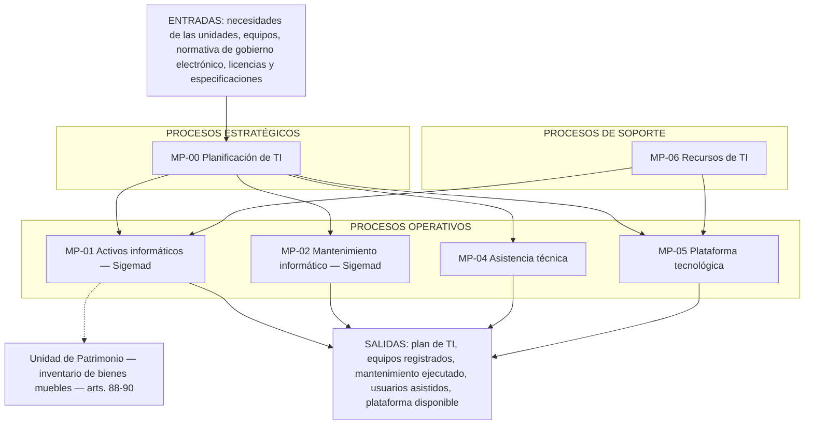

# Mapa de macroprocesos nivel 0

**Prompt:** [P-ISO-001](../../../prompts/iso/P-ISO-001_mapa_macroprocesos_v1.md)  
**Estado:** especificación ajustada el 2026-09-30. Pendiente de revisión humana antes de pasarla a Bizagi.  
**Fuente:** ROF de la Municipalidad Provincial de Acobamba, Ordenanza Municipal N.° 014-2019/MPA, artículos 109 a 111 y 88 a 90.  
**Límite:** Unidad de Tecnologías de la Información y Sistemas (Gerencia de Planificación y Presupuesto).

Sigemad cubre el inventario de activos informáticos (MP-01) y el mantenimiento preventivo y correctivo (MP-02). Entran PC, laptop, monitor, impresora, escáner y los demás equipos que el formulario deja como «Otro». Todos los ve y los registra la Unidad de Tecnologías de la Información y Sistemas. El área usuaria es el lugar donde está el equipo, no quien lleva el inventario. MP-03 Gobernanza del sistema no figura aquí: es apoyo del software y sigue en el inventario de funciones.

La municipalidad no tiene un mapa de procesos aprobado. Este mapa se plantea a partir del ROF (artículos 109 a 111 y 88 a 90) y de la operación del área de informática. En el Anexo 07 la fuente del Bizagi es elaboración propia.

## Clasificación

| Tipo en el mapa | Qué decide | Códigos |
|-----------------|------------|---------|
| **Estratégicos** | Orientan el periodo: plan, lineamientos y continuidad | MP-00 |
| **Operativos** | Entregan el servicio de la unidad a las demás áreas | MP-01, MP-02, MP-04, MP-05 |
| **De soporte** | Habilitan a los operativos y no son el servicio que la unidad entrega | MP-06 |

La Unidad de Patrimonio no entra en ninguna banda. Es otra unidad (Gerencia de Administración) y se dibuja al costado de MP-01.

## Mapa

En Bizagi, tres bandas horizontales con esos títulos. Entradas arriba, salidas abajo.

## Cajas

| Código | Nombre | Tipo | Artículo 111 | Dueño | Entrada | Salida | Sigemad |
|--------|--------|------|----------------|-------|---------|--------|---------|
| MP-00 | Planificación de tecnologías de la información | Estratégico | Nums. 4, 7 y 9 | Jefe de la Unidad de TI | Lineamientos y necesidades de las unidades | Plan operativo del periodo y lineamientos de continuidad | No |
| MP-01 | Gestión de activos informáticos | Operativo | Num. 11 | Jefe de la Unidad de TI | PC, laptop, monitor, impresora, escáner y otros equipos informáticos | Inventario actualizado, a cargo de informática | Sí. El área usuaria no registra |
| MP-02 | Mantenimiento de recursos informáticos | Operativo | Num. 3 | Jefe de la Unidad de TI | Aviso de falla o fecha de preventivo | Mantenimiento preventivo o correctivo ejecutado | Sí |
| MP-04 | Asistencia técnica a usuarios | Operativo | Nums. 6 y 14 | Jefe de la Unidad de TI | Consulta o dificultad de un usuario | Recomendación o asesoramiento entregado | No |
| MP-05 | Operación de la plataforma tecnológica | Operativo | Nums. 5, 8 y 10 | Jefe de la Unidad de TI | Plataforma, red, software en uso y portal | Servicio tecnológico disponible | No |
| MP-06 | Recursos de TI | De soporte | Nums. 12, 16 y 13 | Jefe de la Unidad de TI | Licencias, necesidad de compra, brecha de competencia | Licencias controladas, especificación técnica, capacitación | No |

La contratación no es de esta unidad. MP-06 entrega la especificación técnica; Abastecimiento contrata.

## Desglose

Cada caja tiene as-is y to-be. Donde Sigemad no entra, los dos recorridos son el mismo.

| Código | Dónde está el desglose | Qué cambia en el to-be |
|--------|------------------------|------------------------|
| MP-00 | [MP-00, MP-04, MP-05 y MP-06](./MP-00_04_05_06_as_is_to_be.md) | Nada. El plan sigue fuera del sistema |
| MP-01 | [Activos](./MP-01_activos_as_is_to_be.md), por PR-01-01, PR-01-02 y PR-01-03 | Inventario, ficha y PDF en Sigemad |
| MP-02 | [Mantenimiento](./MP-02_mantenimiento_as_is_to_be.md), por PR-02-03, PR-02-01, PR-02-04 y PR-02-02 | Papel 2024 pasa a cronograma, ficha, historial y PDF |
| MP-04 | [MP-00, MP-04, MP-05 y MP-06](./MP-00_04_05_06_as_is_to_be.md) | La asistencia sigue manual. Si hay falla de un activo, el to-be registra la ficha en MP-02 |
| MP-05 | [MP-00, MP-04, MP-05 y MP-06](./MP-00_04_05_06_as_is_to_be.md) | Nada. Red, software y portal siguen fuera |
| MP-06 | [MP-00, MP-04, MP-05 y MP-06](./MP-00_04_05_06_as_is_to_be.md) | Nada. La especificación puede consultar los conteos de MP-01. Abastecimiento sigue comprando |

## Relación con Patrimonio

La Unidad de Patrimonio (arts. 88 a 90) inventaría los bienes muebles e inmuebles de la municipalidad. El código patrimonial del equipo de cómputo articula esa unidad con MP-01. No es estratégico, ni operativo, ni de soporte de este mapa.
